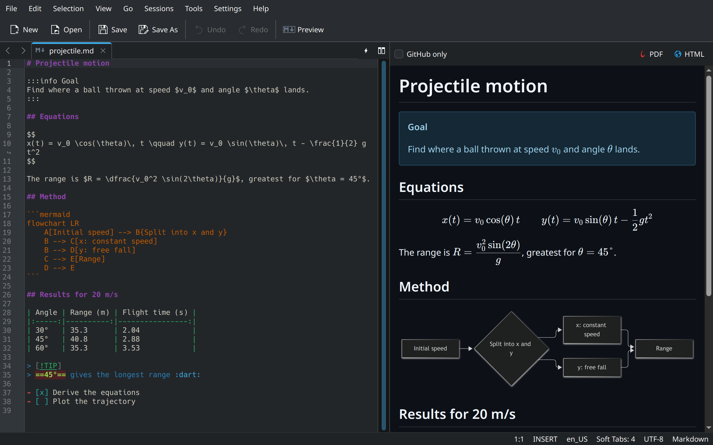
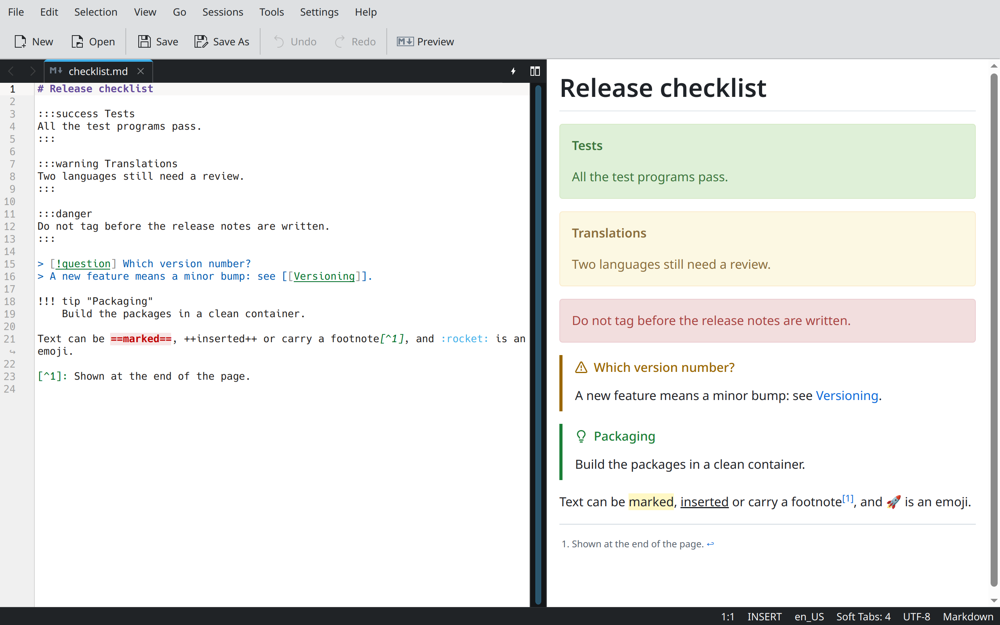
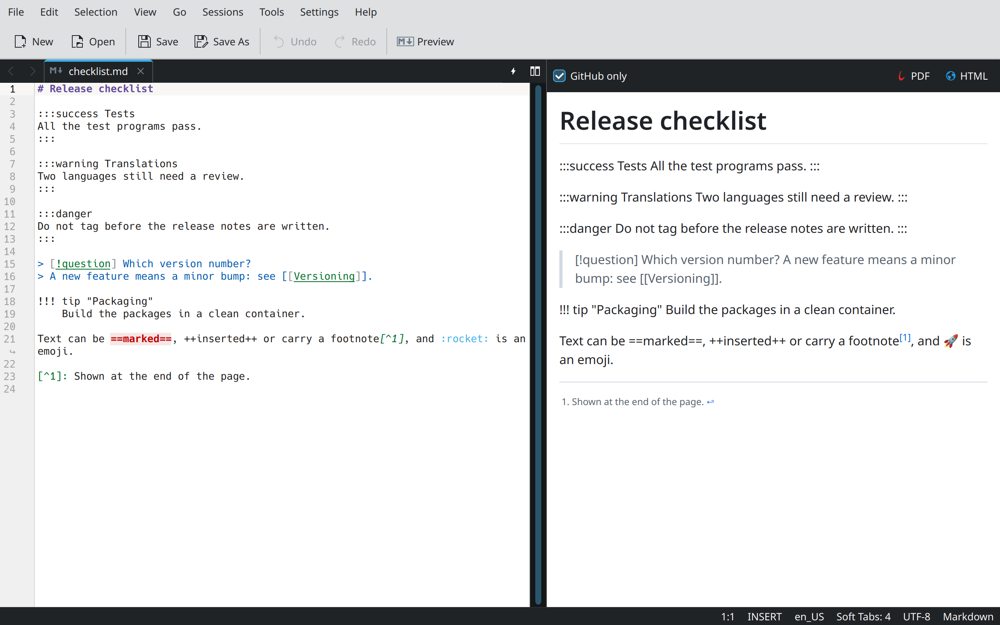
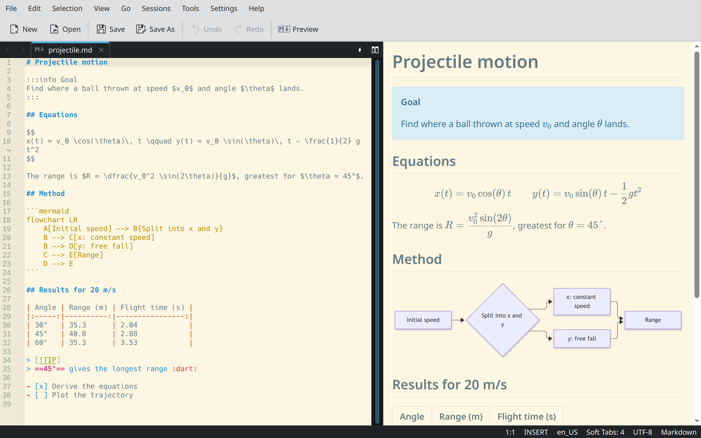

# Katemark

**A Markdown preview for Kate that sits beside your text and looks like GitHub, offline.**

&nbsp;
&nbsp;

Katemark is a plugin for [Kate](https://kate-editor.org), the KDE text
editor. It shows the Markdown document you are editing as GitHub would, in a
panel beside the editor that follows what you type and scrolls with it. The
renderer, the styles and the fonts ship with the plugin, so it works
offline.

This is a fork of [Katdown by
uwuclxdy](https://github.com/uwuclxdy/katdown), which shows the preview in a
tab of its own.

## Screenshots

| CodiMD, Obsidian and MkDocs blocks | The same document with "GitHub only" | The colors of the editor theme |
| :----------: | :----------: | :-----------------: |
|  |  |  |

## Features

| Feature | What it does | From |
|---|---|---|
| GitHub rendering | Headings, tables, task lists, alerts and highlighted code look as they do on github.com | original |
| Two styles | GitHub's colors (light or dark) or the colors of your Kate theme | original |
| Front matter | Shows a YAML header as a table | original |
| Offline | No network request, unless you allow pictures from the web | original |
| Side panel | Docks the preview beside the editor and re-renders it as you type | fork |
| Scroll sync | Scrolling the editor or the preview brings the other to the same place | fork |
| More syntax | markdown-it extensions, CodiMD, Obsidian and MkDocs | fork |
| GitHub only | A check box above the preview leaves out what GitHub would not render | fork |
| Math | LaTeX formulas, rendered by KaTeX | fork |
| Diagrams | Mermaid | fork |
| Export | A PDF, its pages numbered when it has more than one (Qt 6.10 or later), or a single self-contained HTML file | fork |
| Editing actions | Bold, italic, strikethrough, heading level, paste as link, table formatting | fork |
| Image paste | Saves a picture from the clipboard beside the document and links it | fork |
| Languages | 44 interface languages | fork |

## Install

| Your system | What to do |
|---|---|
| KDE neon | [Install the package](docs/install.md#debian-package) `katemark_<version>_neon_amd64.deb` |
| Kubuntu 26.04 | [Install the package](docs/install.md#debian-package) `katemark_<version>_ubuntu26.04_amd64.deb` |
| Windows | [Install the zip](docs/install.md#windows) `katemark-<version>-windows-x86_64.zip` |
| Arch Linux | [Install from the AUR](docs/install.md#arch-linux) `katemark-git` |
| openSUSE Tumbleweed, Leap 16.0 | [Install from KDE:Extra](docs/install.md#opensuse) `katemark` |
| Another Debian or Ubuntu release | [Build the package](docs/install.md#build-from-source) with `build.sh` |
| Any other Linux | [Build from source](docs/install.md#build-from-source) |
| Kubuntu 24.04 | Not possible: its Kate still uses KDE Frameworks 5 |

Kate has to be a KDE Frameworks 6 build, with Qt 6.5 or later. If you
installed Katemark from source before,
[uninstall](docs/install.md#uninstall) it first.

## First steps

1. Enable the plugin: Settings > Configure Kate > Plugins, check
   **Katemark**, click OK.
2. Open a Markdown document: a file ending in `.md`, `.markdown` or `.mkd`.
   A document whose highlighting mode is Markdown counts too. A Mermaid file
   (`.mmd`, `.mermaid`) shows its diagram.
3. Press <kbd>Ctrl</kbd>+<kbd>Shift</kbd>+<kbd>M</kbd>. The preview opens on
   the right of the editor.

The documents in [`examples/`](examples) show what the preview renders:
`github.md`, `codimd.md`, `obsidian.md`, `mkdocs.md`, `teaching.md` and
`mermaid.mmd`.

## Documentation

| File | Contents |
|---|---|
| [docs/install.md](docs/install.md) | Each package in detail, building from source, uninstalling |
| [docs/usage.md](docs/usage.md) | The preview, the editing shortcuts, the settings, troubleshooting |
| [docs/syntax.md](docs/syntax.md) | The Markdown syntax the preview renders |

## Contributing

[`.github/CONTRIBUTING.md`](.github/CONTRIBUTING.md) covers running the
plugin without installing it, the tests, the translations, the layout of the
sources and how the preview works.

No native speaker has reviewed the translations, French apart: corrections
are welcome.

## Credits

Author of this fork: Olivier Booklage (<olivier.booklage@ac-bordeaux.fr>).

Original project: [Katdown](https://github.com/uwuclxdy/katdown) by uwuclxdy
(GPL-3.0-or-later).

Matija Šuklje maintains the Arch Linux package.

Olivier Belleux (Wolfheri) made the openSUSE package and Christophe Marin
added it to `KDE:Extra`.

[THIRD-PARTY-NOTICES.md](THIRD-PARTY-NOTICES.md) lists the bundled libraries and their
licenses.

## License

GPL-3.0-or-later. See [LICENSE](LICENSE).
